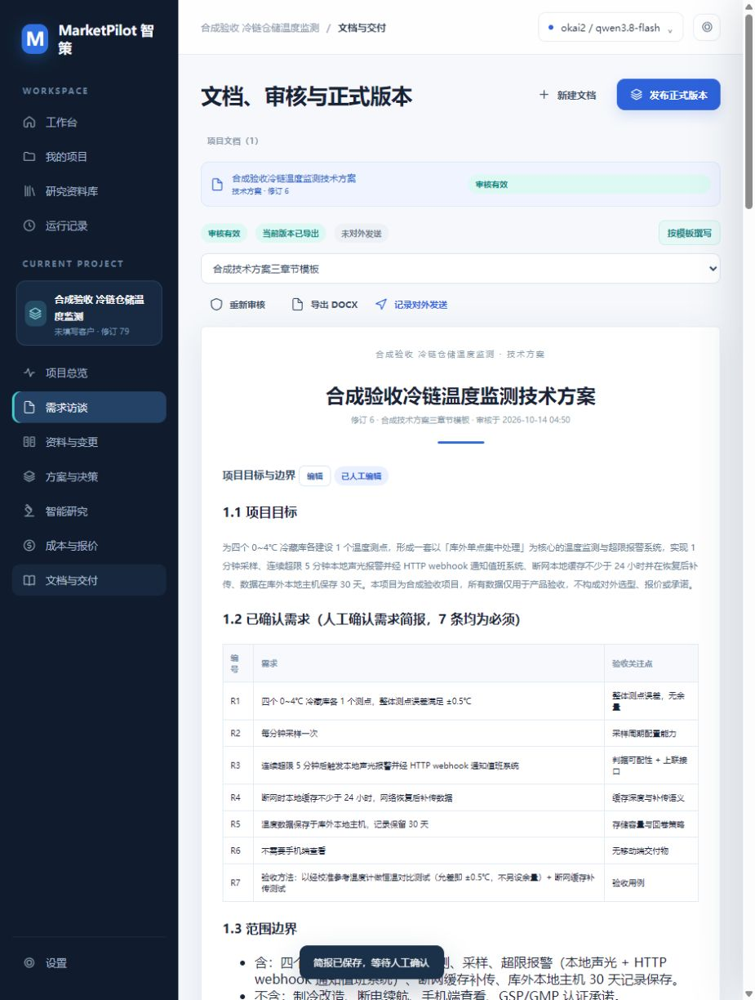

# V4 需求澄清与技术路线探索：功能分支验收

日期：2026-10-14。分支：`feat/v4-guided-discovery`。本报告记录实现及隔离页面验收；验收结束时未正式部署、提交、推送或合并。随后用户授权部署与 Git 提交推送，正式构建、重启和页面点击核对见 [正式部署记录](GUIDED_DEPLOYMENT_REPORT.md)。本报告以下环境状态保留为隔离验收当时的记录。

## 环境与保护范围

- 执行前检查 Git 状态并阅读 README、`DESKTOP_GUI_REPORT.md`、`DSH_AI_RUNTIME.md`。保留原 README 修改、四个 Word 锁文件的删除状态和未跟踪的 `docs/competition-2026/`。
- 正式 Desktop 的插件链接指向本仓库，因此完整构建仅在 `.marketpilot/guided-20261014/plugin/` 内运行，未更新正式使用的根目录 `lib/` 和 `client/client.js`。
- 使用 Desktop 0.11.0 自带 DSH 0.2.0-rc.2 启动独立 `DSH_HOME`，页面地址为 `http://127.0.0.1:3182/marketpilot/workbench`。搜索插件为 `web-search-pro@0.2.1`。
- 仅使用“合成验收 冷链仓储温度监测”项目，ID `93fb506d-d37c-48e0-b3e4-d9b58be1145b`。上传资料、Word 模板、需求、决策及导出文件均为合成数据。
- 正式存储只比较文件哈希，不读取客户正文。验收前后 SHA-256 均为 `10feff86648afe51429214887165d3d89e9283fbc9b4d1d3f53b3ae54da327bd`。正式页面和 client 构建文件的修改时间仍为 2026-10-14 09:28:56。详见 [环境核对记录](guided-discovery/environment-verification.json)。

## 真实执行路径与修改范围

V4 React 工作台通过 HTTP 路由读写资料和草稿；AI 操作通过注册的 `marketpilot_v4_*` 工具进入业务服务，再使用 DSH 提供的模型适配器、模型路由、取消信号及运行记录。联网研究继续调用 DSH web 服务并注入研究 Skill。没有引入厂商 SDK、另一套模型密钥存储或独立 AI 后端。

| 模块 | 本轮主要文件与行为 |
| --- | --- |
| 供应商选择 | `src/workbench-ui/model-picker.tsx`、`ui.tsx`：弹窗挂载到 body，避免顶部 backdrop-filter 改变定位与点击区域；顶部展示供应商及模型 |
| 需求与支撑 | `src/services/v4/discovery.ts`、`discovery-context.ts`、`src/domain/v4.ts`；新增 `pages/discovery.tsx`、`support.tsx`，维护访谈、简报、原文引用和人工固化摘要 |
| 内置提示词 | `src/prompts/discovery.md`、`brainstorm.md`：多轮澄清、收敛条件、实质不同的候选路线、工业支撑、可行性、证据缺口和二次重组 |
| 研究与决策 | `src/services/v4/research.ts`、`solution.ts`、`src/services/decision.ts`；新增 `pages/exploration.tsx`，关联具体方向和路线，限制失效依据和绕过新流程的决策 |
| 模板与交付 | `src/services/v4/docs.ts`、`baseline.ts`、`src/render/docx.ts`、`pages/docs.tsx`：识别 Word 标题/插槽，逐节生成建议、人工接受、审核、导出和上游失效联动 |
| 接口与回归 | `src/harness/v4-routes.ts`、`src/tools/v4.ts`、相关 UI 类型/导航，以及 `tests/v4-discovery.spec.ts`、`v4-model-picker.spec.tsx`、`v4-services.spec.ts`、`v4-formats.spec.ts` 等 |

既有未启用需求访谈的项目保留原工作方式；用户可以显式开启新流程。共享决策服务也执行新流程门槛，不能仅依赖页面按钮限制。HTTP 上传只接收原文并进入精选摘要流程，不逐行生成需求。被引用原文受到覆写保护。

## 七项需求的实际操作结果

| 需求 | 页面操作与结果 | 证据 |
| --- | --- | --- |
| 1. 供应商及模型可选 | 实际切换供应商、读取各自模型并保存；刷新后持久化。后续真实 AI 运行使用所选 `okai2 / qwen3.8-flash` | [供应商弹窗](guided-discovery/02-model-provider.jpg) |
| 2. 新项目先澄清需求 | 新建后进入访谈；完成三轮真实 DSH 问答，追问精度、报警、断网、接口、布线和验收；人工校订简报并通过 Human Gate，形成七条确认需求 | [确认简报](guided-discovery/04-confirmed-brief.txt) |
| 3. 固化必要资料 | 实际上传 104 字现场资料，需求仍为七条，没有自动新增候选。仅将 webhook 和库外网关市电条件整理为一条带原文定位的结构化摘要并人工固化，无关菜单内容未固化 | [精选支撑](guided-discovery/05-fixed-support.txt) |
| 4. 研究前多路线初筛 | 真实模型给出有线 PT、无线、模块化网关、独立记录仪四条路线，各含工业支撑、可行性、证据缺口和不同研究方向 | [初筛](guided-discovery/01-initial-routes.txt) |
| 5. 分方向深度研究 | 从路线建立无线覆盖、记录主机接口两个方向，确认各自计划后联网研究；得到两个独立报告，保留关联路线、来源抓取状态及 Skill receipt | [无线报告](guided-discovery/06-wireless-report.txt)、[接口报告](guided-discovery/07-interface-report.txt) |
| 6. 综合判断与二次重组 | 综合两个报告形成 F1/F2 候选及保留、舍弃、组合理由。先真实取消人工门并核对未写入，再确认 F1 作为有条件的合成验收主线 | [综合](guided-discovery/09-synthesis.txt)、[取消](guided-discovery/10-decision-cancelled.txt)、[确认](guided-discovery/11-final-route.txt) |
| 7. Word 模板交付 | 真实上传三章节 `.docx` 模板，按模板新建文档；DSH 生成三节建议，逐节接受并人工改写，人工门审核后从页面下载 DOCX；在本机 Word 检查全部六页 | [上传模板](guided-discovery/08-template-upload.txt)、[建议](guided-discovery/12-template-proposal.txt)、[审核导出](guided-discovery/13-reviewed-export.txt)、[最终 DOCX](guided-discovery/synthetic-guided-final.docx) |

本次 Word 文件的章节为“项目目标与边界”“技术路线与研究依据”“实施与验收计划”。逐页检查中文、标题、列表、表格、续页和末页完整性；正文加粗现已渲染为 Word 原生加粗。截图为 [第1页](guided-discovery/14-word-page-1.png)、[第2页](guided-discovery/14-word-page-2.png)、[第3页](guided-discovery/14-word-page-3.png)、[第4页](guided-discovery/14-word-page-4.png)、[第5页](guided-discovery/14-word-page-5.png)、[第6页](guided-discovery/14-word-page-6.png)。没有依赖 XML 检查替代 Word 验收。

## 失效、取消、持久化与响应式

- 实际取消最终路线人工门后没有新增确认决策；重新发起并确认成功。
- 隔离服务多次重启后，模型选择、已确认简报、固化摘要、初筛、两个报告、综合候选、决策、Word 模板与文档仍可读取。
- 将简报约束追加“现场施工窗口仅限工作日”，保存后简报转为待确认，旧初筛/综合失效；文档三个章节提示依据变化，审核显示失效，重新审核和发送登记禁用，发布检查不能通过。证据：[路线](guided-discovery/16-stale-routes.txt)、[文档](guided-discovery/16-stale-document.jpg)、[发布阻断](guided-discovery/16-publish-blocked.txt)。
- 验证后通过页面还原该合成约束的原文，内容指纹重新匹配，原审核恢复有效；历史失效证据保留。最终项目停留在可复核的已审核、已导出状态，未对外发送、未发布产品基线。见 [还原状态](guided-discovery/17-restored-context.txt)。
- 实际切换 390×844 视口，点击底部导航检查需求、资料、路线和交付页；无页面横向溢出，操作按钮可达。结束后恢复原视口。截图：[需求](guided-discovery/15-mobile-discovery.jpg)、[资料](guided-discovery/15-mobile-support.jpg)、[路线](guided-discovery/15-mobile-routes.jpg)、[交付](guided-discovery/15-mobile-deliver.jpg)。

实际操作发现并修复了模型弹窗定位、初筛误要求来源路线 ID、接受章节建议后编辑框仍保留旧文、Word 加粗标记原样输出，以及依据失效后仍显示有效审核徽标的问题。另通过回归覆盖并发访谈、过期研究写回、通用模板上下文变化、不兼容模板切换、原文保护和绕过页面的决策路径。

## 工程验证

| 检查 | 结果 |
| --- | --- |
| 全量 `npm test -- --reporter=dot` | 49 文件通过、2 跳过；382 测试通过、3 跳过。此轮在最后 GUI 文档修正之前完成，见 [原始日志](guided-discovery/regression-full.log) |
| 最后修改后的相关回归 | `v4-services`、`v4-downgrade`、`v4-formats`、`v4-discovery`：4 文件通过，83 测试通过、1 跳过；含新增加粗输出检查及上游失效审核检查，见 [日志](guided-discovery/regression-final-targeted.log) |
| UI 定向回归 | `v4-model-picker`、`v4-intake-client`：2 文件、4 测试通过 |
| `npm run typecheck` | 最后代码修改后通过 |
| 隔离副本 `npm run build` | 最后代码修改后通过，见 [构建日志](guided-discovery/build.log) |
| `git diff --check` | 通过 |

## 明确的验证边界

1. **联网链路通过不代表研究证据充分。** 无线方向出现词典页、LoRA 词义混淆和厂商首页；收紧查询后仍缺型号级证据。无线报告重跑有三条正文成功、三条失败；接口方向重试后三条正文成功，但主要是品类信息。报告保留“无法判定/产品可行性未判定”和缺失项。研究 Skill 指纹为 `marketpilot-deep-research@5960e4d525ed`。一次模型服务错误经重试恢复，失败记录保留。
2. 合成 F1 决策只验证人工确认流程，**不构成真实选型或工程可行性背书**。生成文档仍出现计算和推理错误，人工审阅已改正每分钟采样的 30 天记录数（43,200 条/通道）、PT 直连与总线方案的接口差异及验收建议的表述；模型不能替代工程审核。
3. Word 模板范围为 `.docx` 的普通标题 1–3（含中文样式/大纲级别）或明确章节插槽。保留模板 OOXML 容器，替换章节正文；通用插槽、页眉页脚保留和模板冲突有回归覆盖。并未验证任意公司的复杂多节模板、宏、文本框、内容控件或所有 Office 版本。
4. 本轮实际页面来自独立 DSH 服务，Word 来自本机正式 Office。没有对正式 CALM 项目执行操作，没有正式部署；正式 Desktop GUI 点击复核仍须在后续授权部署后进行。
